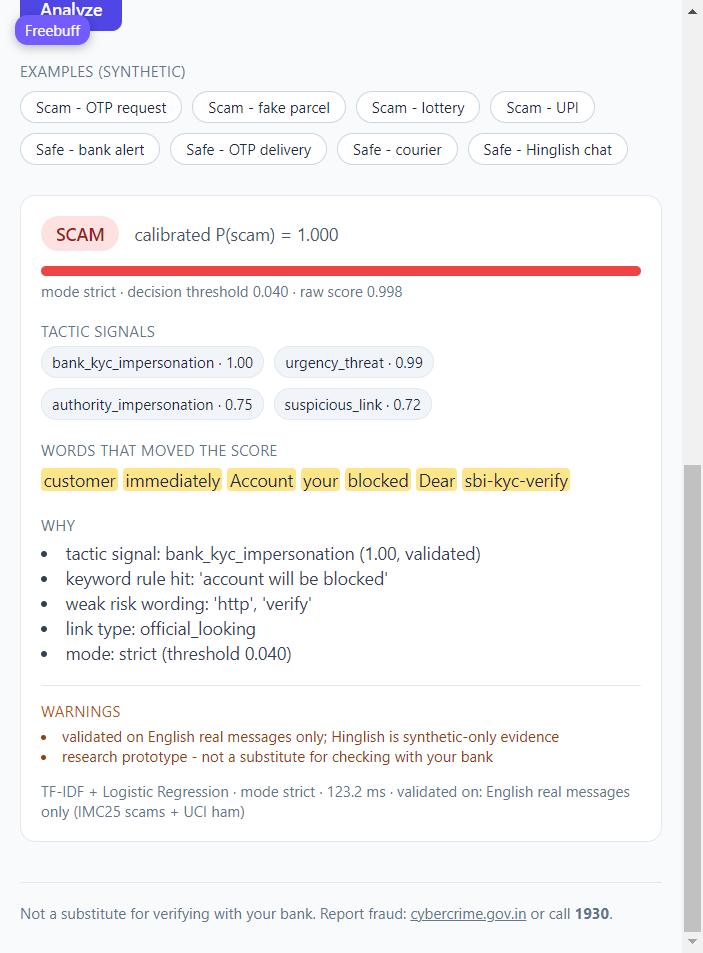
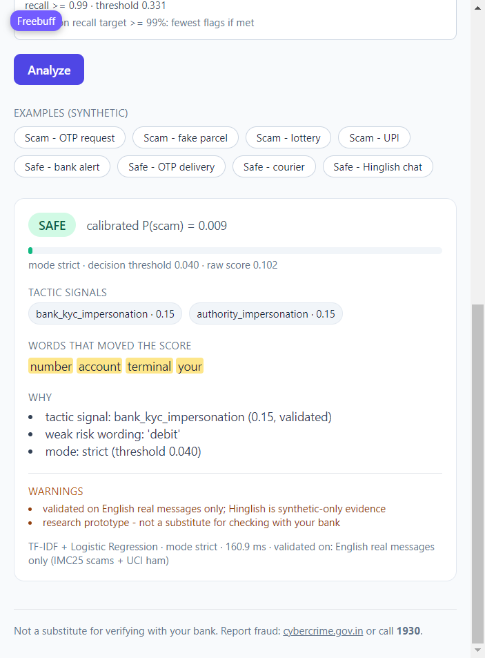

# ScamLens

**A scam-message detector for short Indian SMS/WhatsApp text — built as an honest
research prototype, not a product.**

ScamLens reads one message and returns `scam`, `suspicious` or `safe`, plus the tactic
signals and the words that drove the decision. The interesting work is not the accuracy
number — it's the evaluation discipline: leakage-audited splits, a documented
dataset-source shortcut, three named operating points fitted on validation only, and a
false-alarm rate you can actually see.

> **Status: research prototype. NOT production-ready.** Strict mode still flags **6.4%
> of real English ham (n=345)** and **5.5% of held-out safe-chat probes (n=200)**. Real
> validation is **English-only**. Six tactic tags are **unvalidated**. Nothing here may
> be used to block or report a sender automatically. See
> [`docs/MODEL_CARD.md`](docs/MODEL_CARD.md) and [`docs/CLAIMS.md`](docs/CLAIMS.md).

---

## The problem

Indians receive SMS/WhatsApp scams that look almost exactly like legitimate messages:
a bank debit alert and a fake "KYC will be blocked" notice share *account*, *KYC*,
*link* and *urgent*. A detector that maximises recall will flag real bank alerts — and
a missed bank alert is a worse user experience than a missed scam, because it trains
people to ignore the warning. **The hard part of this project was the safe side, not
the scam side.** Recall was ~99% almost immediately; false alarms took real work.

## Architecture

```
                     ┌──────────────────────────────────────────┐
 raw sources         │  build_dataset.py                         │
 (IMC25 reported     │   ingest → scrub (phones/UPI/URLs) →      │
  scams, UCI ham,    │   dedup → cluster → family-grouped splits │
  synthetic gen)     │   HARD RULE: no synthetic in test_real    │
                     └───────────────┬──────────────────────────┘
                                     │ data/processed/messages.parquet
                                     v
              ┌──────────────────────────────────────────────┐
              │ baselines.py                                  │
              │  TF-IDF (word 1–2 gram) ──► verdict LR        │
              │            └────────────► per-tag LR heads    │
              │ calibrate.py: temperature (val) + 3 operating │
              │   points fitted on WEIGHTED val only          │
              └───────────────┬──────────────────────────────┘
                              │ models/*.joblib, configs/operating_point.yaml
                              v
      ┌────────────────────────────────────────────────────────┐
      │ serving/registry.py  (load once, temperature, mode)    │
      │   ├─ verdict + calibrated probability                  │
      │   ├─ tactics + validated flag (>=20 real positives)    │
      │   ├─ rule hints (keywords.yaml) + link type (scrub)    │
      │   ├─ word-occlusion highlights (capped at 40 words)    │
      │   └─ suspicious rule: score clears, evidence doesn't   │
      └───────────────┬────────────────────────────────────────┘
                      v
        src/api.py (FastAPI)  ──►  static/index.html (UI)
        POST /analyze  GET /health  /model-card  /modes
        logs: length, verdict, latency, mode — never text
```

## Data provenance

| source | role | rows | label origin | license status |
|---|---|---:|---|---|
| IMC25 reported scams (`external_reported`) | real scams | 15,412 | dataset labels (`medium` confidence) | research use; **UNVERIFIED — do not redistribute** |
| UCI SMS Spam Collection (`public_ham_eval`, ham only) | real safe | 2,300 | dataset labels | CC BY 4.0 (attribution) |
| template generator + `safe_v2` hard negatives | synthetic train only | 8,400+ | generator | ours, no external rights |
| self-collected | demo only (10 rows) | 10 | manual | ours |

Full table and per-file notes: [`DATA_LICENSES.md`](DATA_LICENSES.md). Raw text is not
committed; `data/`, `models/`, `outputs/`, `*.parquet`, `*.pt` are git-ignored.

**Splits** (25,161 rows total): train 15,873 · val 4,540 · test_a 667 · test_b 215
(synthetic only) · test_real 3,866 (3,511 real scams + 345 real English ham) · frozen
safe-chat probes 200 · human-`suspicious` holdout 783.

Splits are made **after** dedup and are grouped by template cluster/family, so a
near-duplicate template cannot straddle train and test. `splits35.py` raises if any
synthetic row is marked `test_real`.

## Results — per stratum, never blended

Model: TF-IDF (22,249 features) + Logistic Regression, temperature T=0.4614 fitted on
validation. All thresholds fitted on a **weighted** validation set (real/synthetic ×
scam/safe cells weighted equally); all rates measured on **held-out** data with Wilson
95% intervals.

### The three operating points

| mode | threshold | real ham FPR (95% CI) | safe-chat probe FPR (95% CI) | real scam recall (95% CI) |
|---|---:|---|---|---|
| **strict** | 0.040 | 6.4% (4.2–9.5) n=345 | 5.5% (3.1–9.6) n=200 | 99.2% (98.8–99.4) n=3,511 |
| **balanced** | 0.016 | 9.3% (6.6–12.8) n=345 | 8.0% (5.0–12.6) n=200 | 99.5% (99.2–99.7) n=3,511 |
| **sensitive** | 0.331 | 1.2% (0.5–2.9) n=345 | 0.5% (0.1–2.8) n=200 | 98.2% (97.7–98.6) n=3,511 |

In plain words: **strict** is the default — it misses about 1 in 125 scams and flags
about 1 in 16 legitimate messages. **Sensitive** cuts false alarms five-fold but misses
1 in 55 scams. **Balanced** trades a bit of both. There is no single number that
describes this model; that is why there are three.

Other strata: val macro-F1 0.964 (n=4,540), val balanced accuracy 0.986, synthetic
test_b macro-F1 0.995 (n=215 — synthetic, not a real claim), calibration ECE 0.030 →
**0.005** on the reweighted val.

## Phase 3–4 findings (the parts worth reading)

1. **"Flag everything" nearly passed.** Validation is 83% scam, so predicting `scam`
   for every row scores ~0.83 accuracy. Every headline metric is now balanced accuracy /
   macro-F1 / per-stratum recall + FPR. Accuracy alone is not reported anywhere.
2. **A dataset-source shortcut exists.** A classifier separating real from synthetic
   text reaches **AUROC 0.996**. That means any mixed-set score is partly a source
   detector. Fix: report real and synthetic strata separately, and put a `source_only`
   baseline beside every model number.
3. **The false-alarm bug was partly a data bug.** The pipeline only loaded 400 of the
   ~4,800 licensed UCI ham rows, so the old FPR (15.3%, n=59) was noise. Fixing that
   plus a disjoint hard-negative generator (`src/synth/safe_v2.py`, 2,500 rows, max
   cosine similarity to the frozen probes < 0.7) took real-ham FPR to 6.4% at unchanged
   recall, and safe-chat probes from 13.0% to 5.5%.
4. **The probability band is empty, and we did not fake one.** TF-IDF scores are
   bimodal. `suspicious` is therefore a **rule**: score clears the strict threshold but
   no named evidence supports it (no tactic > 0.5, no OTP/payment/credential wording, no
   risky link, no keyword hit). Measured cost: 1.1% of clear real scams (40/3,511) are
   deferred, 4.6% of clear ham escalated to "check this", and 45.3% of the 783
   human-ambiguous rows are correctly deferred.
5. **Transformer comparison: not run.** E1/E1s (MuRIL) predictions would live in
   `outputs/e1_muril/` and `outputs/e1s_muril/`; that directory is **empty** here — no
   GPU artefacts were produced. So the ship decision is **TF-IDF is the default**, and
   MuRIL stays a documented, config-switchable comparison. The serving config still
   contains the MuRIL entry and the fallback path, which is exercised in tests.
6. **Robustness probes are probes.** Homoglyph/leet/spacing/urgency edits and
   Hinglish transfer move recall by ≈0.1 pt; safe-chat probes are the weak spot. These
   are labelled "scripted probes, not field performance" everywhere.

## Serving

```bash
make serve            # uvicorn src.api:app --port 8000
curl -s -X POST localhost:8000/analyze \
  -H 'content-type: application/json' \
  -d '{"text":"Dear customer, your KYC is expiring today. Account will be blocked. Update: http://sbi-kyc-verify.xyz","mode":"strict"}'
```

```json
{
  "verdict": "scam",
  "scam_probability": 0.998,
  "tactics": [{"tag": "urgency_threat", "prob": 0.97, "validated": true}],
  "reasons": ["tactic signal: urgency_threat (0.97, validated)", "link type: odd_tld", "mode: strict (threshold 0.040)"],
  "highlights": [{"word": "kyc", "weight": 0.21}],
  "warnings": ["validated on English real messages only; Hinglish is synthetic-only evidence", "research prototype - not a substitute for checking with your bank"],
  "model_info": {"name": "tfidf", "mode": "strict", "validated_on": "English real messages only"}
}
```

- `POST /analyze` — text 1–1000 chars; control characters stripped; rate-limited;
  request body capped.
- `GET /health` — model actually loaded, active mode, fallback reason if MuRIL weights
  are missing.
- `GET /model-card` — serves `docs/MODEL_CARD.md`.
- `GET /modes` — the three operating points with their measured recall/FPR.
- **No message text is logged or stored.** Only length, verdict, latency and mode. A
  test proves it by capturing all log records and asserting the text never appears.

UI: `static/index.html` (vanilla JS + Tailwind CDN) — mode selector with the tradeoff
in one line, verdict badge, probability bar, greyed *unvalidated* tactic chips,
highlighted words, warnings panel, 8 labelled synthetic examples (2 are safe bank
alerts), prototype banner, and the fraud-reporting footer.

## Setup & commands

```bash
python -m venv venv && . venv/Scripts/activate     # Windows Git Bash
pip install -r requirements.txt
make data          # ingest -> scrub -> dedup -> splits (leakage guards)
make train         # baselines -> calibrate -> suspicious band
make eval          # evaluate -> phase4 report -> ci_gate
make test          # pytest
python scripts/scan_repo.py    # secrets/PII scan; exits 1 on any hit
```

Docker: `docker build -t scamlens . && docker compose up` (CPU torch, non-root user).
CI (`.github/workflows/ci.yml`): pytest + secrets scan + CPU smoke gate that fails if
synthetic test_b macro-F1 < 0.90 or balanced-mode public-ham FPR > 0.15.

GPU experiments were designed for Kaggle (`notebooks/03_train_colab.ipynb` and the
bundle in `scamlens_bundle.zip`); they were **not run** in this environment (no GPU, no
Kaggle credentials).

## Screenshots

Captured from `make serve` in strict mode (yes, these are the real UI, not mockups):

| scam message | legitimate bank alert |
|---|---|
|  |  |

Both cards show the four things the API returns beyond a verdict: the calibrated
probability, the tactic chips (with `validated` status), the words that moved the score,
and the warnings list. The scam card highlights `customer immediately Account your
blocked Dear sbi-kyc-verify`; the safe card highlights weak signals at 0.15 and says so.

## Limitations

- **6.4% of real English ham is still flagged** in strict mode — but that ham is mostly
  conversational. Only **5 of 345** real ham rows are explicitly bank/OTP text, and 4 of
  those 5 are flagged, so the true false-alarm rate on formal bank notices is **higher
  than 6.4%**. Hand-written debit alerts fail too. Treat 6.4% as the conversational
  number, not the transactional one (see `docs/MODEL_CARD.md`).
- **English-only real validation.** All real evaluation rows are English. Hinglish is
  synthetic + translation-derived only — no real Hinglish accuracy claim exists.
- **Six unvalidated tags** (<20 real positives): `payment_or_upi_request`,
  `prize_or_lottery`, `otp_or_pin_request`, `investment_or_trading_scam`,
  `job_or_task_scam`, `loan_app_harassment`. Their precision is unknown; the UI greys
  them out.
- **Source-origin shortcut (AUROC 0.996)** limits what mixed-set numbers can mean.
- **Bimodal probabilities** mean `scam_probability` is not a confidence statement, even
  after temperature scaling.
- **2023-era scam data**; the probe sets are frozen by design, so reported FPR is a
  fixed reference that will age.
- **No transformer results** exist in this checkout; the MuRIL path is code, not
  evidence.

## Further reading

- [`docs/MODEL_CARD.md`](docs/MODEL_CARD.md) — intended use, metrics, failure modes.
- [`docs/CLAIMS.md`](docs/CLAIMS.md) — what we may and may not say.
- [`docs/DEMO_SCRIPT.md`](docs/DEMO_SCRIPT.md) — 60-second walkthrough + interview Q&A.
- [`docs/TAXONOMY.md`](docs/TAXONOMY.md), [`docs/LABELING_GUIDE.md`](docs/LABELING_GUIDE.md),
  [`docs/DATA_ETHICS.md`](docs/DATA_ETHICS.md).
- Reports: [`results/PHASE4_REPORT.md`](results/PHASE4_REPORT.md),
  [`results/RESULTS.md`](results/RESULTS.md),
  [`results/suspicious_band.md`](results/suspicious_band.md),
  [`results/robustness.md`](results/robustness.md),
  [`results/benchmark.md`](results/benchmark.md).

## License

Code: MIT ([`LICENSE`](LICENSE)). Data: see [`DATA_LICENSES.md`](DATA_LICENSES.md) —
third-party datasets are **not** redistributed here.

Not a substitute for verifying with your bank. Report fraud: **cybercrime.gov.in** or
call **1930**.
